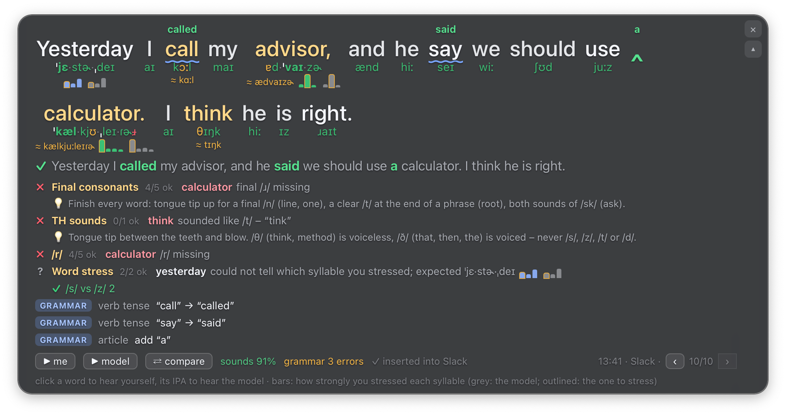

# 🎙 audio_input – dictation that coaches your English

Hold a key, speak, release: the text appears where your cursor is, in any app,
as if you had typed it. A moment later a floating overlay, like desktop lyrics
in a music app, shows the sentence you said with:

- **sounds**: the expected IPA under every word, in syllables with the stress
  mark (ˈkæl·kjʊ·ˌleɪ·ɾɚ), each sound green (heard), amber (another sound was
  heard; what was heard is shown below) or red (not heard);
- **syllable stress**: for every longer word, bars for how strongly you
  stressed each syllable, next to the model voice's bars, with the syllable to
  stress outlined;
- **your focus points**: a pronunciation coach's checks, grouped by area
  with your weak areas first (final consonants, TH, /r/, /s/–/z/, word stress):
  what went wrong ("think: sounded like /t/ – “tink”"), the teacher's tip, and
  the areas that were fine; then extra "uh", reduced small words, pauses,
  intonation and filler words (*um*, *uh*);
- **grammar**: errors underlined, the correction written above the word
  (`he go` → **goes**, a caret ‸ where a word such as *a* is missing), and the
  corrected sentence below;
- **replay and compare**: ▶ me, ▶ model (a macOS voice reads the corrected
  sentence), ⇄ compare (the model, then you); click a word to hear yourself say
  it, its IPA to hear the model; ‹ › to go back through your last 10
  recordings.

Everything runs on your Mac (Apple Silicon); nothing is sent anywhere.



(A sentence spoken by `say`, with mistakes put in on purpose.)

## Models and credits

audio_input is built on these open models and tools; many thanks to their
authors for releasing them. All of them run on your Mac (the Whisper, wav2vec2
and CoEdIT weights are downloaded once from Hugging Face).

| Model / tool | By | Used for | Licence |
| --- | --- | --- | --- |
| [Whisper large-v3-turbo](https://huggingface.co/openai/whisper-large-v3-turbo) ([paper](https://arxiv.org/abs/2212.04356)), in its [MLX conversion](https://huggingface.co/mlx-community/whisper-large-v3-turbo) | OpenAI; conversion by the MLX Community | speech to text on the Apple GPU | MIT |
| [Whisper small.en](https://huggingface.co/Systran/faster-whisper-small.en) for [faster-whisper](https://github.com/SYSTRAN/faster-whisper) (`whisper_backend = "faster"`) | OpenAI; conversion by SYSTRAN | speech to text on the CPU | MIT |
| [Silero VAD](https://github.com/snakers4/silero-vad) (v6, shipped with faster-whisper) | Silero Team | cutting the recording down to the speech | MIT |
| [wav2vec2-lv-60-espeak-cv-ft](https://huggingface.co/facebook/wav2vec2-lv-60-espeak-cv-ft) ([paper](https://arxiv.org/abs/2109.11680)) | Qiantong Xu, Alexei Baevski, Michael Auli (Meta AI) | the sounds you made, as IPA | Apache 2.0 |
| [CoEdIT-large](https://huggingface.co/grammarly/coedit-large) ([paper](https://arxiv.org/abs/2305.09857)), fine-tuned from [Flan-T5-large](https://huggingface.co/google/flan-t5-large) | Vipul Raheja, Dhruv Kumar, Ryan Koo, Dongyeop Kang (Grammarly) | grammar correction | CC BY-NC 4.0 (non-commercial use only) |
| [spaCy en_core_web_sm](https://spacy.io/models/en#en_core_web_sm) | Explosion | parsing the sentences for ERRANT | MIT |
| [ERRANT](https://github.com/chrisjbryant/errant) ([paper](https://aclanthology.org/P17-1074/)) | Christopher Bryant, Mariano Felice, Ted Briscoe | finding and labelling the grammar edits | MIT |
| [eSpeak NG](https://github.com/espeak-ng/espeak-ng), through [phonemizer](https://github.com/bootphon/phonemizer) | the eSpeak NG and phonemizer contributors | the expected IPA and stress of every word | GPL-3.0 |

## Install

On a Mac with Apple Silicon (M1 or newer), paste this line into Terminal:

```bash
curl -fsSL https://raw.githubusercontent.com/Frielon/audio_input/main/install.sh | bash
```

It asks nothing and takes 5–20 minutes, mostly downloads. Everything goes into
one folder, `~/audio_input`:

- the code (cloned with git, or downloaded as an archive when git is missing);
- `.uv/`: [uv](https://docs.astral.sh/uv/), a small Python package manager, and
  the Python 3.11 it downloads;
- `.venv/`: the packages of `requirements.txt` (about 2 GB).

Then it fetches the models from Hugging Face into `~/.cache/huggingface`
(Whisper large-v3-turbo for MLX ≈ 1.6 GB, the grammar model ≈ 3 GB, the phoneme
model ≈ 1.3 GB) by analysing a sentence spoken by `say`, and prints the
feedback, so you see that everything works. Nothing else on your Mac is
changed (no conda, no Homebrew, no shell settings).

Then start it from a Terminal window you keep open:

```bash
~/audio_input/run.sh
```

Run the install line again to update (your `config.toml` and `data/` stay).
`curl … | AUDIO_INPUT_DIR=~/apps/audio_input bash` installs elsewhere, and in a
clone of this repository `./install.sh` sets up that clone.

With conda instead: `conda env create -f environment.yml`, then `./run.sh` (it
uses `.venv` when there is one, otherwise the `audio-input` conda env); the
models are then downloaded on the first start. Once cached, they load in about
10 s; dictation works as soon as Whisper is ready (the menu-bar icon turns from
⌛ into a microphone).

**Uninstall:** `rm -rf ~/audio_input`, and the models in
`~/.cache/huggingface/hub`: `models--mlx-community--whisper-large-v3-turbo`,
`models--grammarly--coedit-large` and `models--facebook--wav2vec2-lv-60-espeak-cv-ft`.

**Permissions.** macOS asks for them on the first start; they belong to the app
you start it from (Terminal, iTerm, VS Code …), in System Settings → Privacy &
Security:

| Permission | Why |
| --- | --- |
| Accessibility | to see the push-to-talk key and to send Cmd+V |
| Input Monitoring | to see the push-to-talk key |
| Microphone | to record |

Restart that app after granting a permission.

## Use

1. Click into any text field (Slack, Mail, a browser, Notes, VS Code …).
2. **Hold the left ⌥ Option key** and speak once the overlay says
   *Listening* (a quarter of a second; a Bluetooth headset needs a moment
   longer, meanwhile the overlay says *Opening the microphone…*).
3. **Release**: the text is inserted at the cursor (about 1 s later), and the
   feedback appears in the overlay.

- **Option keeps working as Option.** Used in a shortcut (⌥← ⌥→ to jump a
  word, ⌥⌫ to delete one, ⌥E for an accent) or with a click, it never opens
  the microphone: dictation starts only when the key is held *alone* for
  0.25 s (`start_delay`). So it is fine if it is the only Option key of your
  keyboard.
- **Esc** while holding cancels. Holds shorter than 0.5 s are ignored.
- Another key: `python -m audio_input --pick-key`, then press the key you want
  (a modifier such as right ⌘, or F13–F20); it is saved in `config.toml`.
- Filler words are left out of the inserted text but are shown in the overlay.
- If another app comes to the front before the text is ready, the text is only
  copied to the clipboard (never typed into the wrong window).
- The overlay **stays on screen** (like desktop lyrics) and never takes the
  keyboard focus. Away from the mouse it fades to 35 % (`idle_opacity`); move
  the mouse over it and it becomes fully opaque. It is also fully visible while
  you speak and for 4 s after a new result (`attention_seconds`).
- **✕** (top right) closes it until your next dictation or until you choose
  *Show the overlay* in the menu-bar icon (double-click does the same).
- **▴ / ▾** (under ✕) folds the mistake details away: the sentence with its
  IPA, the corrected sentence (when there are grammar mistakes) and the button
  bar (▶ me, ▶ model, ⇄ compare, ‹ ›) stay; the focus points, tips, grammar
  notes, what was heard and the stress bars are hidden. Click it again to see
  them; the choice is remembered.
  **Drag** it anywhere (the position is remembered); **right-click** for copy /
  reset position / click-through.

### Replay, compare, look back

The last 10 recordings are kept with their feedback (`data/recent`, also
after a restart). In the overlay:

- **▶ me** plays your recording, **▶ model** the model voice reading the
  corrected sentence, **⇄ compare** the model and then you;
- click a **word** to hear yourself say it, its **IPA** to hear the model say
  it, a coach remark to hear yourself at that spot;
- **‹ ›** go back and forth through the last 10 recordings (or choose one in the
  menu-bar icon's *Recent recordings*); the overlay stays while the mouse is on
  it.

The model voice is analysed like a reference speaker, so its syllable stress
appears as grey bars next to yours.

The **menu-bar icon** (🎙) shows the state (red while listening) and has: *Show
the overlay*, *Recent recordings*, *Insert the corrected sentence* (insert the
grammar-corrected text instead of what you said), *IPA under every word* (off:
only under words with a sound problem), *Overlay ignores the mouse*, *Open
history*, *Practice report* and *Quit*.

### Practice report

Every utterance and its feedback is appended to `data/history.jsonl`.
*Practice report* (or `python -m audio_input.report`, `--html`, `--days 7`)
counts what keeps coming back: grammar error types with examples, the share of
passed checks per focus area, words that keep coming out unclear, and a
**practice text** of corrected sentences to read aloud.

### Command line

```bash
python -m audio_input --help
python -m audio_input --list-devices              # microphones
python -m audio_input --device "BRIO"             # use that microphone
python -m audio_input --pick-key                  # choose the dictation key by pressing it
python -m audio_input --hotkey f13                # or name it (see below)
python -m audio_input --insert-corrected          # insert the grammar-corrected sentence
python -m audio_input --file speech.wav           # analyse a recording, print the feedback (no dictation)
python -m audio_input --file speech.wav --show    # ... and show it in the overlay
```

## Configuration

Copy `config.example.toml` to `config.toml`; every setting is documented there.
The most useful ones:

| Setting | Default | Meaning |
| --- | --- | --- |
| `hotkey` | `left_option` | `right_option`, `right_command`, `right_control`, `fn` (set *Keyboard → Press 🌐 key to* to *Do Nothing*), `f13`…`f20`, `keycode:<n>` |
| `start_delay` | `0.25` | seconds the key must be held alone before the microphone opens (`0`: at once) |
| `input_device` | the macOS default | microphone name or index (`--list-devices`); unset, every dictation uses the macOS default microphone of that moment, also after you change it |
| `insert` | `paste` | `paste`: clipboard + Cmd+V, your clipboard is put back after 0.5 s; `type`: key events (clipboard untouched); `none` |
| `insert_text` | `transcript` | `corrected`: insert the grammar-corrected sentence (waits for the check) |
| `vocabulary` | `[]` | names and terms Whisper should know, e.g. `["Adam", "PyTorch", "Berkeley"]` |
| `whisper_backend` | `auto` | `mlx` (Apple GPU, large-v3-turbo) or `faster` (CPU, `whisper_model = "small.en"`) |
| `focus` | `["final", "th", "r", "sz", "stress"]` | your focus areas: listed first, with the teacher's tips (also `uh`, `rhythm`, `pause`, `focus`) |
| `recent` | `10` | recordings kept to replay and compare (`0`: none) |
| `model_voice`, `tts_voice` | `true`, `Samantha` | the model voice (any English voice of `say -v '?'`) |
| `ipa` | `all` | `errors`: IPA only under words with a sound problem; `off` |
| `overlay_seconds` | `0` | `0`: the overlay stays on screen; otherwise it hides this many seconds after a result |
| `idle_opacity` | `0.35` | opacity while the mouse is not over it (`1`: never fades) |
| `attention_seconds` | `4` | a new result stays fully visible this long before it fades (`0`: only the mouse decides) |
| `keep_fillers` | `false` | `true` inserts "um", "uh" too |
| `keep_audio` | `false` | `true` keeps every recording in `data/recordings` |

## How it works

```
key down ─> microphone (16 kHz) ─> key up
   │
   ├─ Silero VAD: trim to the speech (silence and noise never reach Whisper)
   ├─ Whisper large-v3-turbo (mlx-whisper, Apple GPU)          ~0.8 s
   │    with a spoken-style prompt, so your grammar and fillers are written as said
   ├─ insert at the cursor (clipboard + Cmd+V, then the clipboard is restored)
   └─ feedback, in parallel                                     ~0.3 s
        ├─ sounds: wav2vec2 phoneme recognizer (facebook/wav2vec2-lv-60-espeak-cv-ft)
        │    vs espeak IPA of the transcript, stress, rhythm, the coach's checks
        └─ grammar: CoEdIT (grammarly/coedit-large, Apple GPU, beam search) corrects each
             sentence, the most minimal plausible correction is kept, ERRANT extracts and
             labels the edits; punctuation, casing and spelling edits are dropped (they are
             Whisper's, not yours)
   ─> overlay (WKWebView in a non-activating panel), data/recent (last 10), data/history.jsonl
   └─ then, in the background: the model voice (macOS `say`) reads the corrected sentence and
        is analysed as the reference speaker -> its stress bars, ▶ model, ⇄ compare
```

Dictation has no target sentence, so the transcript stands in for it: the
sounds you produced are compared with the expected sounds of the words Whisper
understood, that is, with what you meant to say.

Project layout:

```
audio_input/
  __main__.py     command line, --file mode, permission check
  app.py          the menu-bar app: hotkey -> recorder -> worker (transcribe, insert, feedback) -> overlay
  hotkey.py       Quartz event tap + push-to-talk state machine (hold / release / cancel)
  recorder.py     microphone capture (sounddevice), opened only while the key is held
  speech.py       VAD trimming + Whisper (mlx-whisper or faster-whisper) with word timings
  inserter.py     paste with clipboard restore / typing, smart spacing (Accessibility API), filler removal
  parrot.py       the sound analysis as the app calls it (phonemes, stress, coach)
  parrot_backend/ phoneme recognizer, alignment with the expected IPA, stress, rhythm, coach
  grammar.py      CoEdIT correction + ERRANT edit extraction, labels and filtering
  feedback.py     transcript + sounds + grammar -> what the overlay shows
  pipeline.py     Engine: transcribe, then sounds and grammar side by side; the model voice's analysis
  recent.py       the last 10 recordings (audio + feedback) in data/recent
  voice.py        the model voice (macOS `say`, cached)
  player.py       playback: you, the model, both, single words
  overlay.py      the floating panel (+ web/overlay.html); clicks are matched to the page's regions
  statusbar.py    menu-bar icon and menu
  history.py      data/history.jsonl
  report.py       practice report (text / HTML)
tests/            pytest; test_pipeline_slow.py runs the real models (AUDIO_INPUT_SLOW_TESTS=1)
install.sh        the one-line installer: the code, uv + Python 3.11, .venv, the models
requirements.txt  the Python packages (install.sh: .venv; environment.yml: a conda env)
```

## Tests

```bash
.venv/bin/python -m pytest                         # unit tests, ~3 s, no models
AUDIO_INPUT_SLOW_TESTS=1 .venv/bin/python -m pytest  # + the models on speech synthesized with `say`
```

(With conda: `conda activate audio-input`, then `python -m pytest`.)

The unit tests never touch your clipboard or keyboard (they use a private
pasteboard).

## Notes and limitations

- **Whisper hears what you meant.** It writes your grammar as you said it in
  most cases (*he go*, *she don't*, *I have went* stay as they are), but when
  two versions sound almost the same it may write the correct one: *ask me*
  and *asked me* differ only by a /t/ that is often silent. The sound feedback
  then still shows the missing /t/ under *asked*.
- **The phoneme recognizer** was trained on dictionary pronunciations and can
  "hear" the expected sound of a common word in context. Treat a single amber
  sound as a hint and a sound that keeps coming back in the practice report as
  the thing to practise.
- **Secure input:** in password fields (and while an app such as a password
  manager or Terminal's *Secure Keyboard Entry* is active) macOS hides the
  keyboard from all apps, so the key does nothing.
- **Bluetooth headsets** need about a second to switch to their microphone.
  Start speaking when the overlay says *Listening*, or use another
  microphone: choose it as the input in System Settings → Sound (audio_input
  follows it, no restart needed), or set `input_device`.
- **Keyboard layouts:** Cmd+V is sent as the key in the V position of a US
  layout. With Dvorak or Colemak use the "… – QWERTY ⌘" variant of the layout,
  or `insert = "type"`.
- **Smart spacing** reads the character before the cursor through the
  Accessibility API; apps that do not expose it (some Electron apps) get no
  automatic space.
- Your last 10 recordings stay on disk in `data/recent` (and nowhere else);
  set `recent = 0` to keep none.
- Run it from a terminal you keep open, for example a tab you leave running.
  The permissions belong to that terminal app.

## Licence

The code is under the MIT licence ([LICENSE](LICENSE)). The models have their
own licences (see [Models and credits](#models-and-credits));
`grammarly/coedit-large` is CC BY-NC 4.0, for non-commercial use only.
